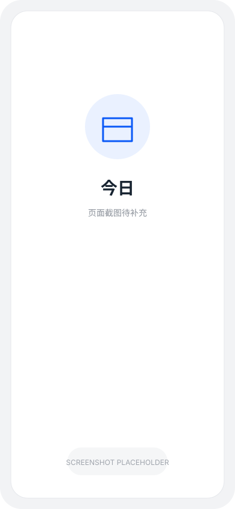
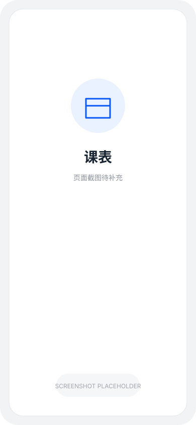
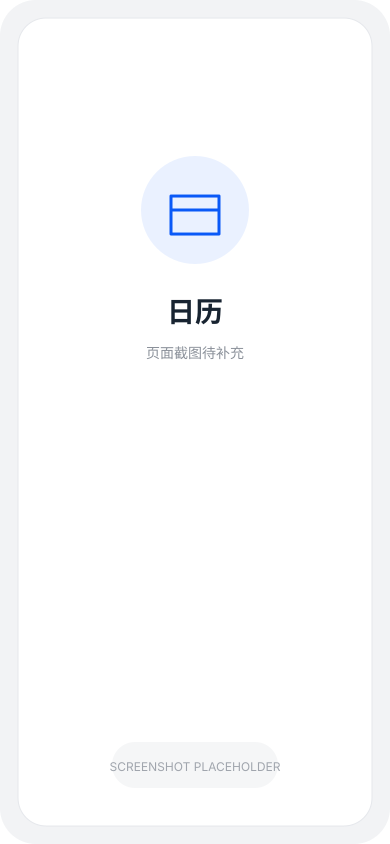
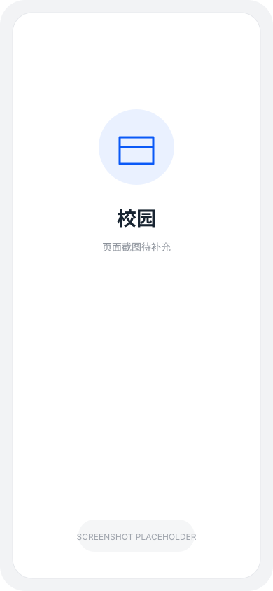
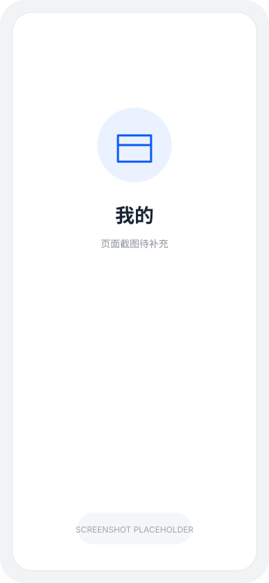

<div align="center">


# 工大助手

**广东工业大学 · HarmonyOS NEXT 校园助手**

课表 · 日历 · 校园服务 · 图书馆 · 成绩 · 空教室

[](https://developer.huawei.com/consumer/cn/harmonyos/)
[](https://developer.huawei.com/consumer/cn/doc/harmonyos-references/)
[](https://github.com/sseaan/GDUT-Helper/releases)
[](LICENSE)
[](https://github.com/sseaan/GDUT-Helper/actions/workflows/build-unsigned.yml)

[功能](#功能) · [截图](#截图) · [快速开始](#快速开始) · [构建](#构建) · [文档](#文档) · [隐私](#隐私与安全)

</div>

## 简介

工大助手是面向广东工业大学学生的原生 HarmonyOS NEXT 校园助手，围绕“本地优先、少打扰、可离线查看”设计：

- 原生统一认证登录教务，同步课表、考试、成绩和学期；
- 课表、今日、日历、空教室联动，支持单周停课/调课；
- 校园新闻、校园卡、图书借阅、校园网余额集中查看；
- 内置图书馆 OPAC，可查看当前借阅和可借额度；
- 不依赖自建服务端，账号密码只保存在系统安全存储。

> 当前版本：`1.1.0`<br>
> 最低兼容：HarmonyOS 6.1.0（API 23）<br>
> 开发/测试环境：API 26 / Mate 80 Pro Max 模拟器 / SGT-AL10

## 功能

| 模块 | 主要能力 |
|---|---|
| **今日** | 今日课程、下一节课、本周课程概览、跨天自动刷新 |
| **课表** | 周课表、单周停课/调课、手动课程、考试/日程、课程详情 |
| **日历** | 月视图 / 周视图、课程与考试标记、日期高亮移动、新建课程/日程 |
| **校园** | 校园新闻、校园数据、成绩/GPA、体测、空教室、图书馆 OPAC |
| **我的** | 姓名/头像、主题模式、三套主题色、沉浸光感强度、本地通知、数据备份 |

其他能力：

- 统一认证 CAS 原生登录，支持自动重登；
- 图书馆 CAS → 超星 passport → `jwt` 原生会话；
- 系统日历同步：标题为课程/日程名，备注为 `地点 · 教师 · GDUT Helper`；
- 本地通知：同步完成等即时提醒，不依赖代理提醒能力；
- 数据迁移：JSON 备份/恢复、ICS 导出、ICS/XLSX 导入；
- 沉浸光感：跟随系统 / 精致 / 柔和 / 流畅；
- 桌面课程卡片与今日卡片；
- GitHub Actions 构建 unsigned HAP，侧载安装。

## 截图

> 以下仅预留底栏五个页面的截图位置，替换 `docs/screenshots/` 下对应文件即可。

| 今日 | 课表 | 日历 | 校园 | 我的 |
|:---:|:---:|:---:|:---:|:---:|
|  |  |  |  |  |

## 技术栈

| 层级 | 实现 |
|---|---|
| UI | ArkTS / ArkUI / HDS（UIDesignKit） |
| 导航 | `HdsNavigation` + `HdsTabs` 悬浮底栏 |
| 数据 | RDB、Preferences、系统 Asset Store |
| 网络 | `@kit.NetworkKit` + CookieJar，原生 CAS |
| WebView | 校园新闻详情、图书馆统一认证兜底 |
| 系统能力 | CalendarKit、NotificationKit、WorkScheduler、FormKit |
| 构建 | hvigor / DevEco Studio / GitHub Actions |

## 快速开始

### 环境

- DevEco Studio 6.1 或更高版本
- HarmonyOS SDK API 23+（当前开发使用 API 26）
- 已配置 HarmonyOS 模拟器或真机

### 本地构建

```bash
# Debug
./scripts/build-debug.sh

# Release
./scripts/build-debug.sh release
```

产物：

```text
entry/build/default/outputs/default/entry-default-signed.hap
```

### 侧载安装

```bash
hdc install -r entry/build/default/outputs/default/entry-default-signed.hap
```

### 首次使用

1. 打开「我的 → 登录教务系统」完成统一认证；
2. 在同步页选择当前学期，预览后导入课表；
3. 可选开启系统日历同步、本地通知、桌面卡片；
4. 在「我的 → 外观」调整主题色、光感强度和页面动效。

## 构建

### unsigned HAP

仓库内置 [`Build unsigned HAP`](.github/workflows/build-unsigned.yml)：

- push / pull request / 手动触发；
- 使用 `setup-ohos` 安装 HarmonyOS SDK；
- 自动移除本地 `signingConfig`；
- 构建并上传 `gdut-helper-unsigned-hap` Artifact。

这条路径不接触证书和密码，适合构建留档和后续本地签名。  
> 注意：HarmonyOS 安装仍要求 HAP 签名；直接 `hdc install` 安装 unsigned HAP 会报 `9568332 install sign info inconsistent`，请用 DevEco/本地自动签名对下载的 HAP 重新签名后再侧载。

详细签名说明见 [`docs/SIGNING.md`](docs/SIGNING.md)。

### 项目结构

```text
entry/src/main/ets/
├── ability/                 # UIAbility 入口
├── auto/                    # WorkScheduler 自动同步
├── card/                    # 桌面卡片
├── common/                  # 主题、材质、导航、工具
├── components/              # 通用卡片、底栏图标、新闻卡片
├── data/                    # RDB 与仓库层
├── domain/                  # 课表/日程/同步模型与引擎
├── pages/                   # 今日/课表/日历/校园/我的及二级页
├── services/                # 教务、门户、图书馆、备份、通知
└── state/                   # AppStorage 状态与设置
```

更完整的开发记录和接口说明见 [`AGENT.md`](AGENT.md) 与 [`docs/`](docs/)。

## 隐私与安全

- 账号密码仅保存在系统 Asset Store；
- 密码、Cookie、JWT、ticket、验证码不写入日志、Preferences、RDB 或备份；
- 备份不包含登录凭据、系统日历映射；
- 文件导入/导出通过系统文件选择器，不申请宽泛存储权限；
- 本地通知内容仅在设备本地生成；
- 详细说明：[`docs/PRIVACY.md`](docs/PRIVACY.md)。

## 文档

| 文档 | 内容 |
|---|---|
| [`AGENT.md`](AGENT.md) | 开发记录、架构、发版检查清单 |
| [`docs/DESIGN.md`](docs/DESIGN.md) | 设计基线：底栏、材质、图标、动效 |
| [`docs/PORTAL_DATA.md`](docs/PORTAL_DATA.md) | 融合门户与校园新闻接口 |
| [`docs/LIBRARY_API.md`](docs/LIBRARY_API.md) | 图书馆 OPAC 登录与接口 |
| [`docs/API_EXPLORATION.md`](docs/API_EXPLORATION.md) | 教务/空教室/体测接口调研 |
| [`docs/SIGNING.md`](docs/SIGNING.md) | 签名与侧载说明 |

## 致谢

- **HarmonyOS / ArkUI / HDS**：系统能力与组件基础；
- **Goke**：教务、空教室接口调研与交互参考；
- **XJAU-Helper**：悬浮底栏、材质与设置页设计参考；
- **Helechron**：沉浸光感、通知、ICS 与 CI 方案参考；
- 所有提供反馈、课表样本和建议的同学。

## License

本项目采用 [GNU Affero General Public License v3.0](LICENSE)。

> 工大助手与广东工业大学官方无隶属关系。校园接口可能随学校系统调整而变化，请以实际服务为准。
